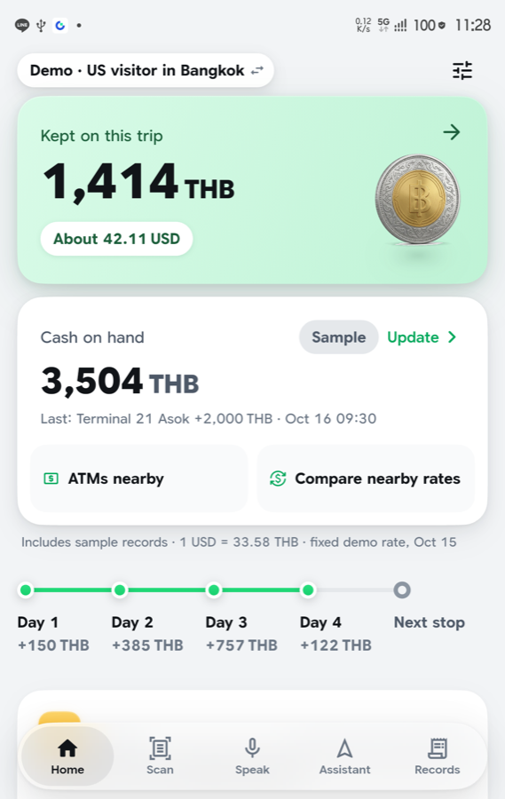
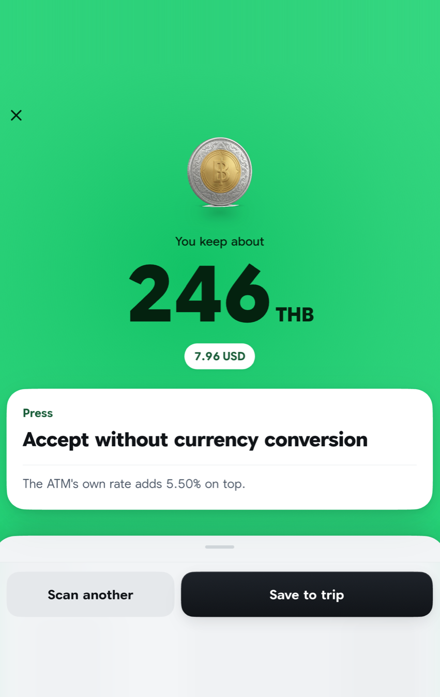
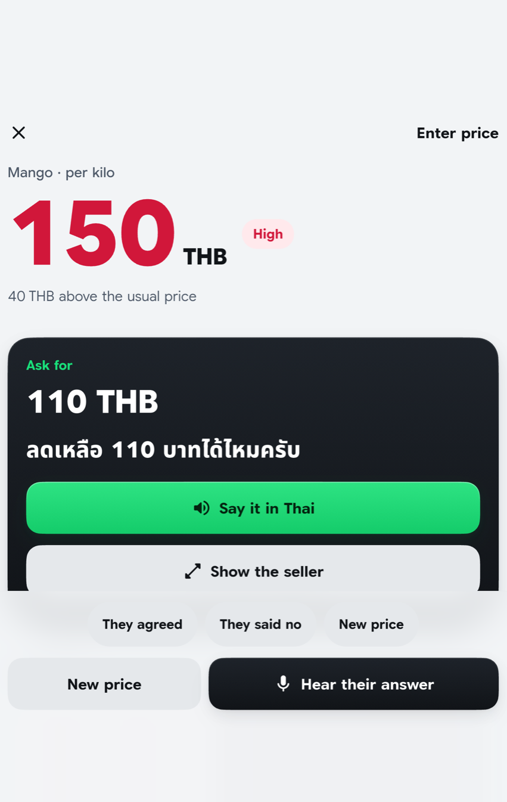
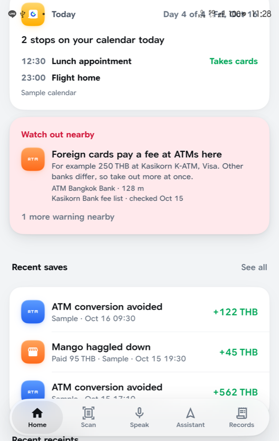
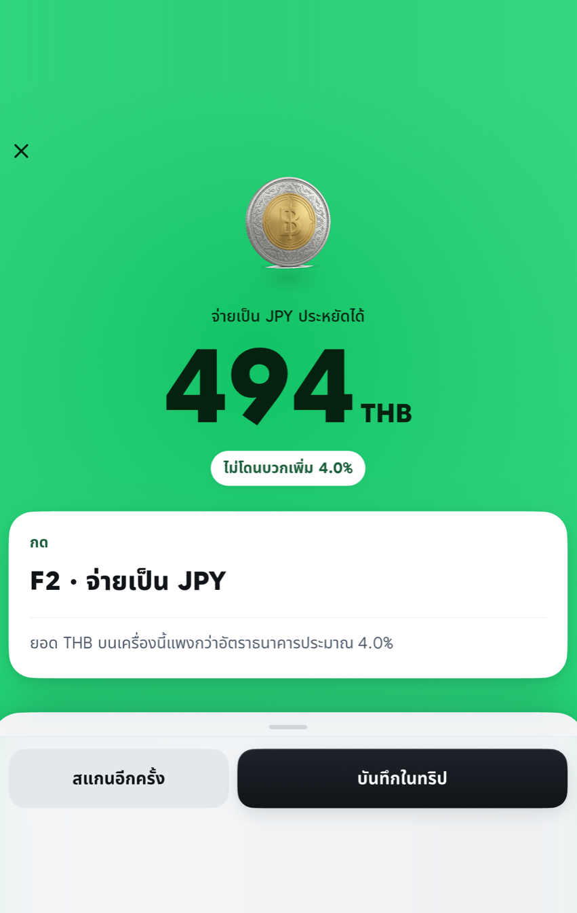

# Money Navigation – AI travel assistant

**Watch:** [1-minute demo video](docs/media/money-navigation-demo.mp4) · **Try it:** [iPhone (TestFlight)](https://testflight.apple.com/join/N1jHDdtN) · [Android APK](https://github.com/g326555-lab/money-navigation/releases/tag/v1.0.0-7) · [Demo website](https://storage.googleapis.com/money-navigation-site/index.html) · [Pitch deck](https://drive.google.com/file/d/1ychfMfByIASrZP4x0RncA1AnccbObzLr/view?usp=sharing)

> Maps tells you which way to go. Money Navigation tells you which way to pay.

Built for **U-Hackathon 2026** (AI track, Bangkok, 15–16 Oct 2026).

<p>





</p>

## How I built it

I'm not a developer. I worked as a product planner, so I know how features should connect and where the logic belongs, but I don't write code myself. Every line of code here was written by AI coding agents. My job was the planner's job: decide what to build, set the rules, check every result, and say no when something was faked or wrong.

**Before the event (planning only, no code):**
- Researched the problem: ATM conversion fees, card-terminal currency choice, market prices, Thai bills. I collected real photos and sources.
- Wrote the planning documents the agents would follow: the product overview, a design system ([`docs/DESIGN.md`](docs/DESIGN.md)), reference apps and an "avoid the AI look" checklist.
- Wrote the working rules in [`CLAUDE.md`](CLAUDE.md), with the exact demo numbers as expected results.

**During the 25 hours (180 commits):**
- **One coordinator, many workers.** I talked to one AI session acting as project manager. It split the work across about eight parallel sessions (scan UI, voice haggling, home and assistant, AI and backend, sign-in, Part B rules, release, pitch). Each session owned its own folders.
- **A shared board.** The sessions coordinated through [`docs/BOARD.md`](docs/BOARD.md), with lock files for builds and for the test phone. I added these rules after real collisions: agents overwrote each other's files, and two iOS builds broke an archive.
- **Rules that keep the AI honest:**
  - No hard-coded results. Demo data lives in one labelled file.
  - Every outside figure shows its source and date.
  - All money math is pure, tested code: 33 rule files and 1,700+ tests, with the demo numbers as test cases.
  - AI output is checked, never trusted. A bill counts as verified only if the arithmetic adds up. A web price counts only if its quote appears word for word on the fetched page.
- **Review loop per screen:** tests first → build → a fresh-eyes reviewer agent (PASS/FAIL) → fix → a polish pass → review again → commit.
- **My decisions along the way:**
  - Google Maps for the trip map.
  - How the app knows it is the same shop: same name *and* within 100 m. Otherwise a 7-Eleven branch would count as a repeat visit.
  - A daily automatic re-check of online facts, with sources.
  - A live web price lookup for items not on the list.
  - A researched 3-day trip as the demo traveler's sample data.
- **Real-person testing.** The agents tested on a real Galaxy Fold the way a person would: open from the icon, tap the real UI, and speak Thai through a speaker in quiet and noisy rooms. I prepared the demo props (ATM screen, card terminal, Thai bill) and checked every result by hand.
- **Handoff.** When my AI usage ran out near the deadline, the coordinator wrote [`docs/HANDOFF.md`](docs/HANDOFF.md). A different AI tool (Codex) picked up from it and continued.

What I took away: AI agents can write the code, but someone still has to own the product. That means clear rules, one point of coordination, and checking the result on a real phone instead of trusting "tests pass".

## The problem

Travelers lose money in small, quiet ways every time they pay abroad. A Thai ATM asks "charge in your home currency?" and a tap adds about 5%. A card terminal in Japan offers THB or JPY and the wrong choice costs hundreds of baht. Exchange counters, restaurant bills (service charge on top, VAT inside) and market prices hide the same kind of trap. Most people never notice.

## What the app does

Like a navigation app, but for the cheapest way to pay:

| Navigation | Money Navigation |
| --- | --- |
| Fastest route | Cheapest way to pay here (card, cash or QR) |
| Speed camera warning | Trap warning (ATM conversion, terminal currency choice, inflated prices) |
| Route preview | Morning briefing: what today's plan needs |
| Trip summary | Money kept on this trip |

**AI and on-device intelligence**

- **Camera scan of ATM screens and card terminals.** Text is read on the phone; the app says which button to press and what the wrong button costs. Figures printed on the screen are preferred over outside data.
- **Thai bill reading.** Google Vision OCR plus Gemini read Thai receipts; every result is checked by arithmetic (subtotal, discount, service charge, VAT). A bill is marked "verified" only when the numbers add up.
- **Market haggling by voice.** Thai speech recognition hears the seller's price, judges it against a sourced usual range, and reads a counter-offer aloud in Thai. "Show to seller" displays the sentence full screen.
- **Live price lookup for items outside the list.** A web search feeds Gemini, and a range is accepted only if the number's quote appears verbatim in the fetched page. Otherwise the app says "no sourced range".
- **Daily fact re-check** of payment facts, with the same verbatim-quote rule.
- **Calendar briefing.** Reads title, place and time of today's events and adds Google Maps payment facts for each stop.
- **Cash on hand ledger.** Tracks only real movements: opening balance, ATM withdrawals, exchange payouts, cash purchases. Nothing is forecast or invented.
- **Nearby ATMs map** with walking directions.
- **Live exchange-counter rates** from ThaiRate (CC BY 4.0), ranked by matching currency and banknote tier, with freshness checks per shop.
- **Card catalogue** built from issuers' official pages, with on-device card-face recognition that drops card numbers.

## Demo states

Settings > Demo (or the pill on Home) swaps between two prepared states:

1. **US visitor in Bangkok** (English): ATM scan (about 246 THB saved by declining conversion), haggling for mangoes (150 THB asked, usual 80–110, counter 110), restaurant bill, exchange board.
2. **Thai traveler in Tokyo** (Thai): card terminal choice F1 THB / F2 JPY (about 494 THB saved by paying in JPY).

Fixed demo rates and sample records live only in `app/assets/data/demo_*.json` and are always labelled *Sample*. The scans, calculations and voice flow run for real on the printed props.

## Architecture

```
app/                      Flutter app (Android + iOS)
  lib/rules/              pure money functions, no Flutter imports, unit-tested
  lib/core/               design tokens (colors, type, spacing, motion)
  lib/l10n/               English and Thai strings
  lib/features/           scan, speak, home, assistant, records, trip_map, auth, demo ...
  lib/services/, data/    camera/OCR/speech/TTS clients, repositories
  assets/data/            sourced price ranges, card catalogue, demo samples
  supabase/               migrations and Edge Functions
docs/                     design system, handoff, research notes
pitch/                    pitch deck and script
public-site/              privacy policy page
```

- **Flutter** UI. All money math lives in `lib/rules/`; widgets never calculate.
- **Supabase**: auth, Postgres with row level security, Edge Functions (`gemini`, `read-text`, `stt-thai`, `tts-thai`, `places-*`, `price-reference`, `facts-refresh`, `exchange-rates*`).
- **API keys exist only in Supabase function secrets.** The app holds just the public anon key and map keys passed at build time.

## Run it

Requirements: Flutter 3.47.6 (Dart 3.13.5), Xcode for iOS (minimum iOS 15.5), a Supabase project with the Edge Functions deployed.

Create two config files (not in the repo; see `.gitignore`):

- `app/env/supabase.json` with keys `SUPABASE_URL`, `SUPABASE_ANON_KEY` and the Google sign-in client ids.
- `app/env/maps.json` with keys `MAPS_ANDROID_KEY`, `MAPS_IOS_KEY`.

```bash
cd app
flutter pub get
flutter run --release --dart-define-from-file=env/supabase.json
```

iOS archive: `cd app && tool/prepare_ios_archive.sh env/supabase.json`, then archive `ios/Runner.xcworkspace` in Xcode. Android: `flutter build apk --release --dart-define-from-file=env/supabase.json`.

## Testing

```bash
cd app
flutter analyze
flutter test
```

1,700+ tests: unit tests for every calculation (the demo numbers above are test cases), plus widget tests. `flutter analyze` is clean.

## Privacy

- Photos are processed for text on the device; receipt photos stay on the phone.
- Card numbers are never stored. Card recognition keeps only issuer, product and fee facts.
- Voice is kept as text only, not audio.
- Calendar access reads title, place and time only.
- The app gives information for the user's own decision, not personal investment advice.

## Data sources and attributions

- Exchange-counter rates: ThaiRate public board feed, CC BY 4.0.
- Place data and maps: Google Places and Google Maps Platform.
- Speech, text-to-speech and OCR: Google Cloud Speech, Text-to-Speech, Vision. Reasoning: Gemini.
- Market price ranges: `app/assets/data/market_prices.json`, each with its source and research date.
- Card fees and terms: issuers' official public pages, shown with their source links.
- Every figure from outside the app shows its source and date.

## Honest limitations

- After the hackathon the paid Google Cloud APIs (Vision, Speech, Text-to-Speech, Places, Maps) were switched off to avoid charges. In the public builds, scans read on the phone, haggling with a typed price and the demo states still work; receipt reading, cloud voice, place lookups and map tiles do not, until they are switched back on.
- Demo mode uses fixed rates and sample records, labelled *Sample*.
- Voice recognition needs a network and degrades in loud places; one loud-market test misheard the item. A typed price is the fallback.
- Receipt check: 22 of 31 real photos fully verified, none falsely verified; the rest are marked unverified.
- Sign in with Apple is not verified on an iPhone. The cash ledger is device-local (not account-synced). No low-cash notification yet.
- The exchange-rate cache refresh job was deployed shortly before submission and its 15-minute schedule was not yet observed running.
- Not verified at submission time: the full final demo walk on the release build and the map on the Galaxy Fold cover screen.
- Gemini runs on a free key and may be slow; every Gemini use is optional and the app works without it.
- Nearby results depend on location permission and network.
